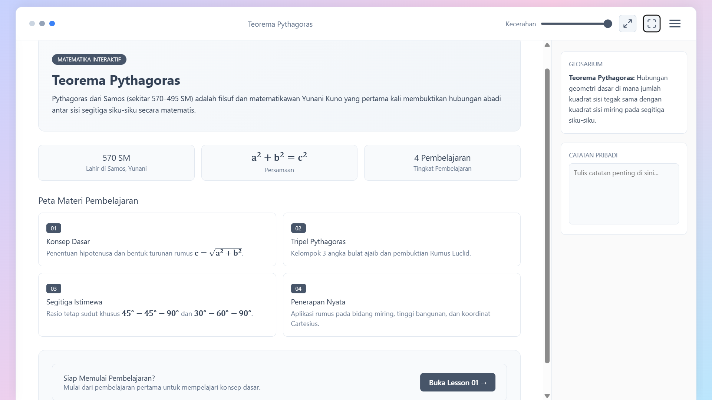
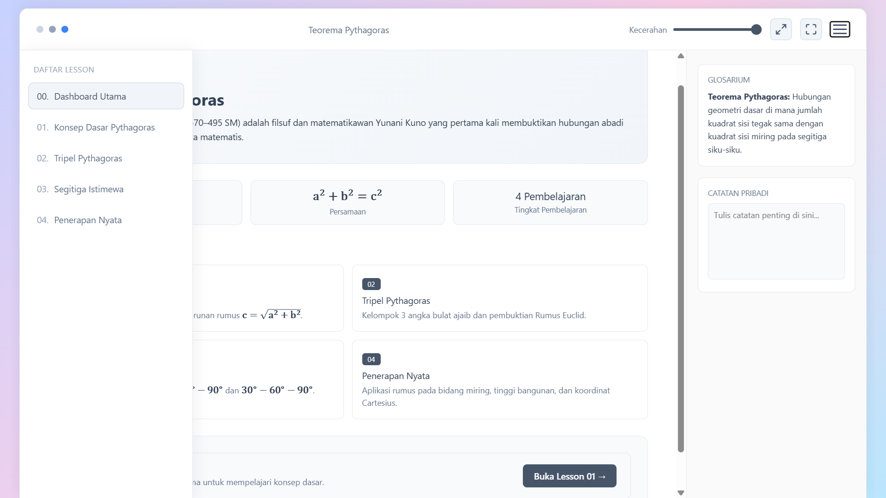
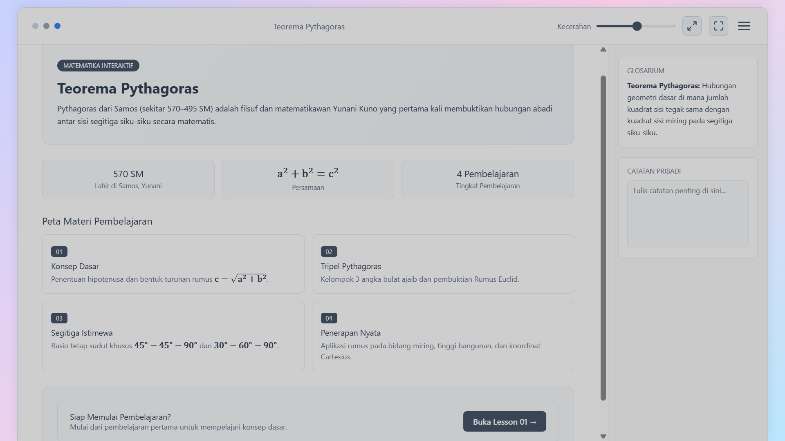

# Pythagoras Interactive Reader

Pythagoras Interactive Reader adalah aplikasi modul interaktif berbasis web yang dirancang untuk membantu pembelajaran materi Teorema Pythagoras secara visual, intuitif, dan terstruktur. Aplikasi ini dilengkapi dengan parser Markdown, engine render formula matematika, widget interaktif, serta fitur kenyamanan membaca seperti pengaturan kecerahan dan catatan pribadi.

## Fitur Utama

- Materi Pembelajaran Terstruktur:
  - Dashboard: Ringkasan awal dan navigasi modul.
  - Konsep Dasar: Pengenalan konsep Teorema Pythagoras.
  - Tripel Pythagoras: Identifikasi kombinasi angka tripel.
  - Segitiga Istimewa: Pembahasan sudut khusus ($30^\circ-60^\circ-90^\circ$ dan $45^\circ-45^\circ-90^\circ$).
  - Penerapan Nyata: Studi kasus dan implementasi soal cerita kehidupan sehari-hari.
- Render Formula Matematika (KaTeX): Menampilkan rumus dan persamaan matematika secara rapi dan presisi menggunakan pustaka lokal KaTeX.
- Dukungan Markdown (Marked.js): Konten materi dimuat dan diproses dari format Markdown.
- Fitur Kenyamanan Pembaca:
  - Pengatur Kecerahan: Slider brightness bawaan untuk penyesuaian kenyamanan mata.
  - Mode Fullscreen Ganda:
    - Pseudo Fullscreen: Pengujian layar penuh berbasis tab (memudahkan debugging).
    - True Native Fullscreen: Mode layar penuh (browser native).
- Panel Samping Interaktif:
  - Glosarium: Daftar istilah penting terkait materi.
  - Catatan Pribadi: Area teks khusus bagi siswa atau pengguna untuk menulis catatan saat belajar.

## Teknologi & Pustaka

Aplikasi ini dibangun menggunakan arsitektur front-end murni (Vanilla Web) tanpa dependensi build tool eksternal:

- HTML5 & CSS3: Struktur tata letak dan pengayaan visual UI.
- JavaScript (ES6+): Logika aplikasi, manipulasi DOM, dan pemuatan materi.
- Marked.js (Lokal): Parser teks Markdown ke HTML.
- KaTeX (Lokal): Engine pemroses dan perender ekspresi matematika.

## Struktur Direktori Projek

    Pythagoras Interactive Reader
    ├── index.html                # Berkas utama HTML aplikasi
    ├── css/
    │   └── style.css             # Berkas gaya kustom (UI Reader & Layout)
    ├── config/
    │   └── lessons.js            # Konfigurasi urutan & metadata lesson
    ├── content/                  # Modul konten materi pembelajaran
    │   ├── 00-dashboard.js
    │   ├── 01-konsep-dasar.js
    │   ├── 02-tripel-pythagoras.js
    │   ├── 03-segitiga-istimewa.js
    │   └── 04-penerapan-nyata.js
    ├── images/                   # Gambar preview aplikasi
    │   ├── images_1.png
    │   └── image_2.png
    ├── js/                       # Logika skrip utama
    │   ├── app.js                # Inisialisasi & kontroler aplikasi utama
    │   ├── md-loader.js          # Pemroses & pemuat konten Markdown
    │   └── widgets.js            # Komponen & elemen interaktif
    └── lib/                      # Pustaka dependen lokal
        ├── katex/                # Pustaka KaTeX (CSS & JS)
        └── marked/               # Pustaka Marked.js

## Cara Menjalankan Aplikasi
- Unduh / Clonisasi Repository
  - Pastikan seluruh struktur folder terunduh secara lengkap.
  - Buka Aplikasi: Buka atau klik ganda berkas index.html langsung menggunakan peramban web (seperti Google Chrome, Microsoft Edge, Mozilla Firefox, atau Safari).
- Panduan Penggunaan
  - Navigasi Materi: Klik tombol menu (ikon burger) untuk membuka panel daftar lesson, lalu pilih topik yang ingin dipelajari.
  - Membaca & Memahami Rumus: Teks materi dan rumus matematika akan ter-render otomatis di area utama.
- Menggunakan Fitur Tambahan:
  - Geser slider Kecerahan di baris atas untuk mengatur tingkat pencahayaan area baca.
  - Gunakan tombol Fullscreen untuk memperluas tampilan baca.
  - Tulis poin penting pada kotak Catatan Pribadi di panel sebelah kanan selama proses pembelajaran.

*Catatan: Dokumentasi ini dibuat dengan bantuan AI (Created with AI assistance).*
